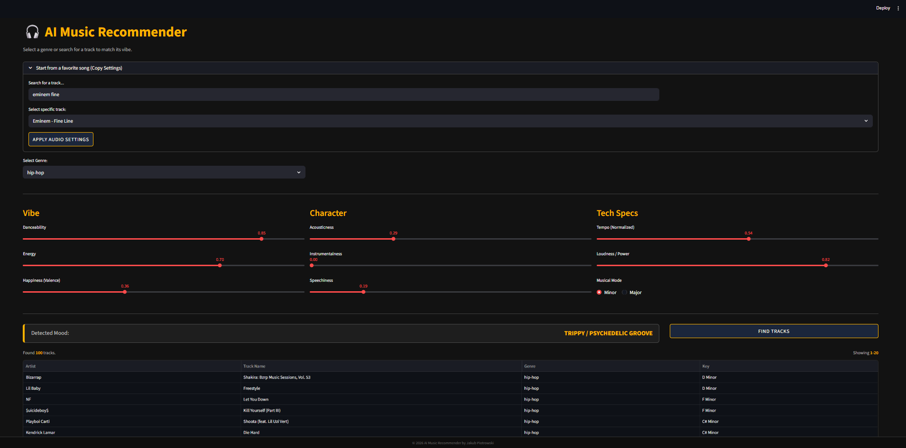

# AI Music Recommender

[](https://github.com/JacobPi8/ai-music-recommender/actions/workflows/tests.yml)

Intelligent music recommendation application written in **Python** built with **Streamlit**. The system analyzes audio features (energy, danceability, valence) and uses machine learning to find songs that perfectly match the user's **musical taste**.

The recommender can also be used by an **AI assistant** (OpenCode, Claude Desktop, Claude Code) through an **MCP server** – just describe what you want to listen to in a chat.

<p align="center">
  
</p>

## Features

- **Advanced Recommendation Engine** – Uses **Cosine Similarity (PyTorch)** to calculate mathematical distance between user preferences and the song database.
- **Real-time Mood Analysis** – Live classification algorithm that labels the mood (e.g., *Euphoric / Hyper*, *Melancholic*, *Chill*) based on slider adjustments.
- **Track Mirroring** – Search for a favorite song (e.g., *Rihanna - Stay*) and instantly copy its audio attributes to use as a starting point.
- **Hybrid Sorting** – Smart filtering that balances audio similarity with track popularity.
- **AI Assistant (MCP Server)** – AI chat apps can search tracks and get recommendations from the engine (e.g. *"calm music for studying, similar to ..."*).
- **Automated Tests** – Unit tests with **pytest**, run on every push by **GitHub Actions**.

## How It Works

1. **Data** – about 1 million Spotify tracks with audio features (danceability, energy, valence, tempo, ...).
2. **Normalization** – every feature is scaled to the 0-1 range (MinMaxScaler).
3. **Similarity** – the user's sliders form a vector, compared with every track using **Cosine Similarity** (PyTorch).
4. **Ranking** – the 300 most similar tracks are sorted by popularity.
5. **Mood** – a rule-based algorithm labels the mood from valence, energy, tempo (BPM), loudness (dB) and more.

The **MCP server** gives the same engine to an AI model as 4 tools: `search_tracks`, `recommend_by_features`, `recommend_similar` and `list_genres`. The AI turns a request like *"something calm without vocals"* into audio features (e.g. `energy=0.2, instrumentalness=0.8`), calls the tools and shows the results.

## Tools & Sources

- [Python 3.13](https://www.python.org/)
- [Streamlit](https://streamlit.io/)
- [PyTorch](https://pytorch.org/)
- [Scikit-learn](https://scikit-learn.org/)
- [Pandas](https://pandas.pydata.org/)
- [MCP Python SDK](https://github.com/modelcontextprotocol/python-sdk)
- [Pytest](https://pytest.org/)
- [Git](https://git-scm.com/)

## Dataset

The project uses the [Spotify 1 Million Tracks](https://www.kaggle.com/datasets/amitanshjoshi/spotify-1million-tracks) dataset by **Amitansh Joshi** (Kaggle), collected with the Spotify API (tracks from 2000-2023).

License: Database - [Open Database License (ODbL)](https://opendatacommons.org/licenses/odbl/1-0/), Contents - © Original Authors.

The dataset is **not included** in this repository. Download `spotify_data.csv` from Kaggle and put it in the `data` folder:

```text
ai-music-recommender/
└── data/
    └── spotify_data.csv
```

## Installation & Usage

### 1. Clone the repository

```sh
git clone https://github.com/JacobPi8/ai-music-recommender
cd ai-music-recommender
```

### 2. Setup Environment

It is recommended to use a virtual environment.

#### Windows

```sh
# Create virtual environment
python -m venv .venv

# Activate environment
.\.venv\Scripts\Activate
```

#### macOS / Linux

```sh
# Create virtual environment
python3 -m venv .venv

# Activate environment
source .venv/bin/activate
```

### 3. Install Dependencies

```sh
pip install -r requirements.txt
```

### 4. Download Dataset

Download the dataset as described in the [Dataset](#dataset) section.

### 5. Run Application

```sh
streamlit run main.py
```

## How to Use

- **Select Genre** – Choose a specific genre or stick with "All Genres".
- **Adjust Sliders** – Tweak the sliders (Energy, Danceability, Valence) to define your desired atmosphere.
- **Start from Track** *(Optional)* – Type a song name (e.g., `Rihanna Stay`) to auto-set the sliders based on that track.
- **Get Recommendations** – Click **FIND TRACKS** to see the list of best-matching songs.

## AI Assistant (MCP Server)

You don't start the MCP server yourself – the AI app starts it in the background. You only need to connect it once.

### OpenCode

The project already contains an `opencode.jsonc` file. Activate the virtual environment and start OpenCode in the project folder:

```sh
opencode
```

### Claude Code

Activate the virtual environment and run in the project folder:

```sh
claude mcp add music-recommender -- python mcp_server.py
```

### Claude Desktop

Open **Settings → Developer → Edit Config** and add the server to `claude_desktop_config.json` (use your own paths):

```json
{
  "mcpServers": {
    "music-recommender": {
      "command": "C:\\path\\to\\ai-music-recommender\\.venv\\Scripts\\python.exe",
      "args": ["C:\\path\\to\\ai-music-recommender\\mcp_server.py"]
    }
  }
}
```

Restart Claude Desktop.

### Example

- *"Recommend me calm music for studying, without vocals."*
- *"Find songs similar to Rihanna - Stay."*
- *"I need energetic rock for running."*

The first request takes a few seconds, because the dataset is loaded into memory.

## Tests

```sh
pip install -r requirements-dev.txt
pytest
```

The tests use a small fake dataset, so they don't need the Kaggle file.
